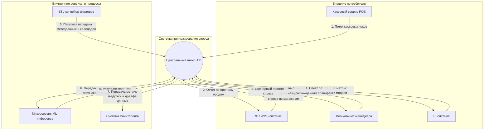

# Дисциплина «API-технологии»

## Практическая работа № 1
### Анализ API-сценариев бизнес-системы с элементами ИИ: потребители, ресурсы, данные, контекстная схема

| | |
| :--- | :--- |
| **ФИО студента** | Подлесных Марк Владимирович |
| **Группа** | ДЭ 18-25 |
| **Дата выполнения** | 20.09.2026 |

---

## 1. Выбранный бизнес-сценарий

*Отметьте выбранный сценарий и кратко опишите его в 1–2 предложениях.*

- [x] **Прогнозирование спроса для розничной сети**
- [ ] Прогнозирование урожайности для агропредприятия
- [ ] Кредитный скоринг аграрного предприятия
- [ ] Интеграция ERP / CRM / BI

**Краткое описание сценария:**  
Система аккумулирует исторические данные кассовых продаж, текущие складские остатки и параметры маркетинговых акций, рассчитывая с помощью ML-модели прогноз покупательского спроса на товары для торговых точек сети. Сервис предотвращает дефицит продукции на полках (out-of-stock), исключает затоваривание складов скоропортящимися позициями и автоматизирует график поставок.

---

## 2. Потребители API

*Заполните таблицу потребителей интерфейса. Добавьте строки при необходимости.*

| Потребитель | Тип (внешний / внутренний) | Зачем обращается к системе |
| :--- | :--- | :--- |
| **ERP / WMS-система сети** | Внешний | Получение расчетного прогноза спроса для автоматического формирования заказов поставщикам и оптимизации складских запасов. |
| **Кассовый сервис (POS-терминалы)** | Внешний | Передача транзакционного потока чеков и фактов продаж в режиме реального времени. |
| **Веб-кабинет категорийного менеджера** | Внешний | Запрос сценарного прогнозирования продаж с учетом промо-акций и ручная корректировка графиков поставок. |
| **BI-система корпоративной аналитики** | Внешний | Регулярный забор исторических данных план-фактного анализа и метрик точности модели для дашбордов. |
| **ETL-конвейер внешних факторов** | Внутренний | Пакетная загрузка производственных календарей (праздничные дни), метеоданных и курсов валют. |
| **Микросервис ML-инференса** | Внутренний | Прием нормализованного вектора признаков товара и вычисление ожидаемого объема продаж. |

---

## 3. Ресурсы и данные

*Опишите, какие данные (ресурсы) система должна предоставлять или принимать. Формулируйте как существительные, а не действия.*

| Ресурс / данные | Кто использует | Формат представления (справочник, отчёт, событие и т.д.) |
| :--- | :--- | :--- |
| **Кассовый чек** (идентификаторы позиций, количество, стоимость, скидка, время, ID кассы) | Кассовый сервис (POS) | Поток событий / транзакция |
| **Номенклатурный справочник** (категории, SKU, сроки годности, минимальные кванты заказа) | Веб-кабинет менеджера, ERP-система | Справочник |
| **Реестр промо-акций** (периоды проведения кампаний, глубина скидок, медиаканалы) | Веб-кабинет менеджера | Реестр / календарь |
| **Прогноз спроса** (расчетный объем продаж по SKU в разрезе конкретного магазина и даты) | ERP / WMS-система, Веб-кабинет менеджера | Аналитический отчет |
| **Метрики качества модели** (ошибки прогнозирования WAPE, MAPE, отклонения факта от плана) | BI-система | Отчет / агрегированная статистика |

---

## 4. Место API в жизненном цикле системы

*Отметьте этапы, на которых вашей системе требуется API, и кратко поясните, зачем.*

| Этап жизненного цикла | Нужен ли API (да / нет) | Пояснение |
| :--- | :---: | :--- |
| **Сбор данных** | **Да** | API требуется для приема потока кассовых чеков с торговых точек и пакетной загрузки планов акций из маркетинговых сервисов. |
| **Обработка данных** | **Нет** | Внутренний этап: дедупликация, валидация чеков и агрегация продаж до дневных таймфреймов выполняются внутри хранилища данных. |
| **Обучение модели** | **Нет** | Модель обучается оффлайн на исторических датасетах внутри изолированного вычислительного контура. |
| **Инференс (применение модели)** | **Да** | Критический этап: внешние сервисы через API передают параметры запроса и получают рассчитанный объем спроса в реальном времени. |
| **Мониторинг** | **Да** | API отправляет телеметрию о задержках ответов, сбоях и дрейфе признаков (data drift) во внешнюю систему мониторинга. |

---

## 5. Контекстная схема

---

## 6. Таблица интерфейсов

*Каждая строка соответствует одной стрелке (связи) на контекстной схеме.*

| Кто инициирует обращение | Что запрашивает / передаёт | Кто отвечает за обработку | Краткое назначение связи |
| :--- | :--- | :--- | :--- |
| **Кассовый сервис (POS)** | Передает массив данных о закрытых чеках и проданных товарах | Центральный сервис системы | Наполнение аналитического контура первичными данными о реальных продажах сети. |
| **ERP / WMS-система** | Передает ID торговых точек и горизонт дат $\rightarrow$ запрашивает прогноз спроса | Центральный сервис системы | Автоматизация пополнения складских остатков и заказа партий у поставщиков. |
| **Веб-кабинет менеджера** | Передает параметры планируемой акции $\rightarrow$ получает пересчитанный прогноз | Центральный сервис системы | Моделирование эффекта скидок и маркетинговых активностей на динамику продаж. |
| **BI-система** | Запрашивает исторические данные сопоставления «прогноз / факт» | Центральный сервис системы | Построение корпоративных дашбордов для оценки финансовой эффективности сети. |
| **ETL-конвейер** | Передает пакет календаря праздников и метеорологических сводок | Центральный сервис системы | Обогащение обучающей и прогнозной выборки внешними факторами спроса. |
| **Центральный сервис системы** | Передает вектор признаков товара $\rightarrow$ возвращает целевое значение спроса | Микросервис ML-инференса | Выполнение расчета предсказания обученной математической моделью. |
| **Центральный сервис системы** | Передает логи запросов, задержки ответов и метрики распределения | Система мониторинга | Непрерывный контроль стабильности сервиса и обнаружение деградации качества модели. |

---

## 7. Вопросы для подготовки к защите

*Кратко ответьте письменно — эти пункты пригодятся во время устной защиты работы.*

* **Почему выбраны именно эти потребители API?**  
  Состав потребителей полностью охватывает ключевые звенья розничной торговли: кассовый узел выступает первичным источником фактов продаж, ERP/WMS системы используют результаты для непосредственного управления цепочками поставок, категорийные менеджеры управляют промо-акциями, а BI-модуль отслеживает финансовую отдачу и ошибки прогнозов.

* **Почему ресурсы описаны именно так?**  
  Ресурсы сформулированы строго в виде существительных («Кассовый чек», «Номенклатурный справочник», «Прогноз спроса»), так как в парадигме REST API система оперирует ресурсами как устойчивыми бизнес-объектами, а не процедурами. Форматы (поток событий, реестр, отчет) подобраны исходя из физической природы данных.

* **На каком этапе жизненного цикла системы API наиболее критичен и почему?**  
  Наиболее критичным является этап **Инференса (применения модели)**. На этом шаге модель напрямую интегрирована в операционные процессы бизнеса: если API инференса будет недоступен, ERP-система не получит расчеты вовремя, сорвутся автоматические графики поставок со складов и возникнет дефицит товаров на полках магазинов.